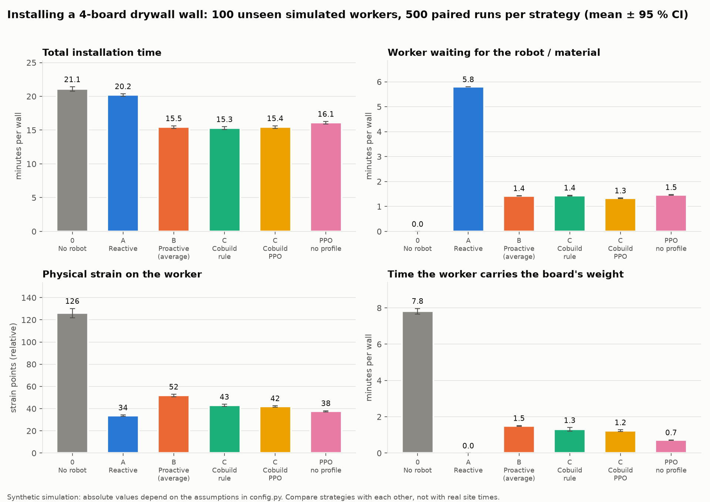
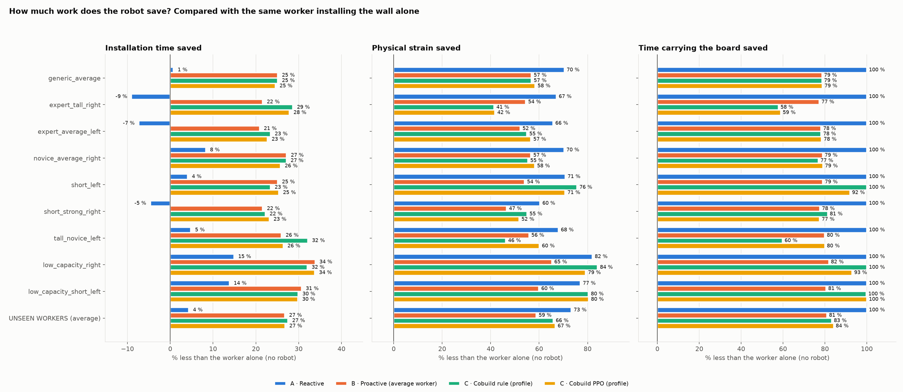
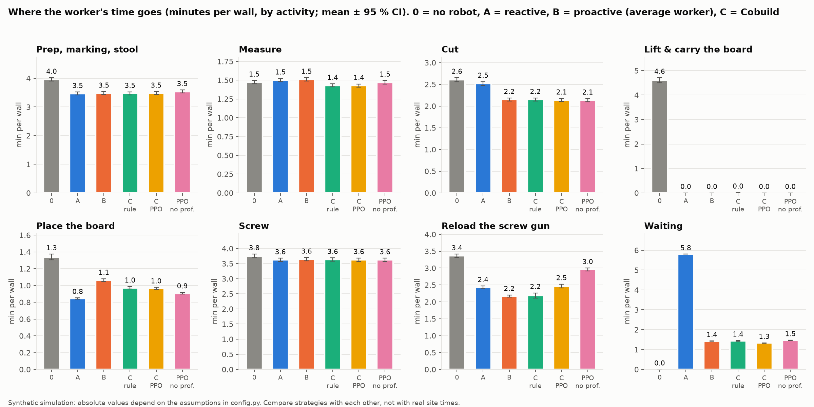
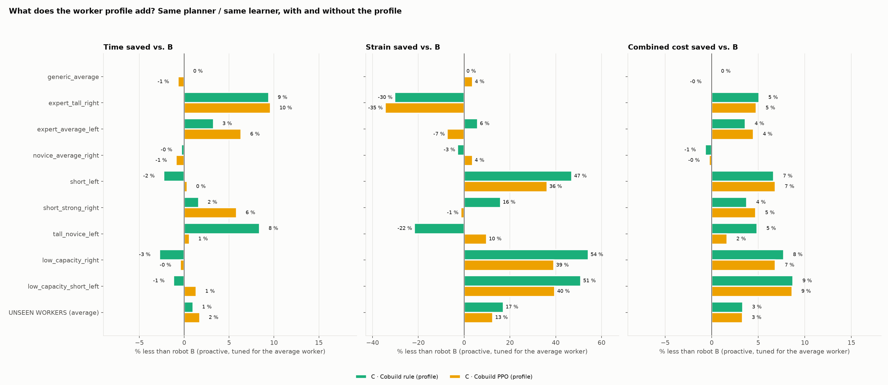
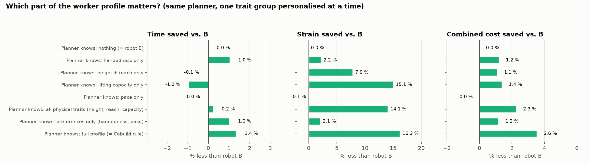
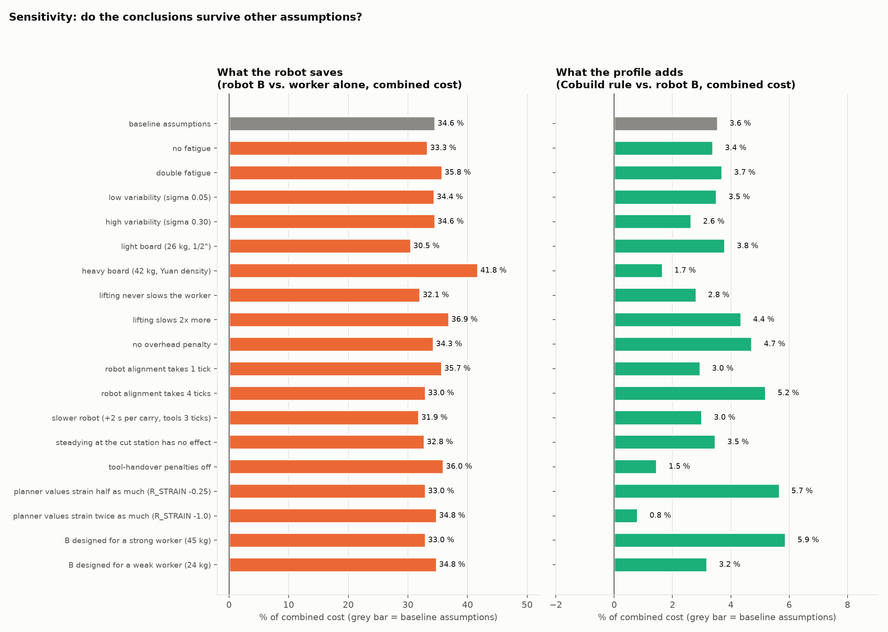

# Cobuild: personalised robotic assistance for drywall installation (v2)

IAAC Research Studio · team 4 (Emma, Amelia, Karthik)

> **Research question:** can worker-specific profiles improve task efficiency compared to non-personalised proactive robotic assistance in construction?

A robot arm assists a drywall installer covering a wall with 4 boards. It can **carry boards**, **lift and hold a board against the studs**, **steady a board at the cutting cart** and **hand over tools** (cut tools, a pre-loaded screw gun). Each worker has a **profile**: pace and handedness, plus **physical characteristics** (height, reach, lifting capacity, fatigue). We repeat the installation hundreds of times with different robots and measure how much **time** and **physical strain** the robot, and the profile, save.

* 📚 **Where the procedure and the numbers come from:** [docs/RESEARCH.md](docs/RESEARCH.md)
* 📖 **How the model works, the reward, why the comparison is fair, limitations:** [docs/MODEL.md](docs/MODEL.md)

---

## Run it from scratch (anyone, in about 5 minutes, no training needed)

The trained models (`models/`) and the results (`results/`) are in the repository, so you can reproduce the figures and the videos without training. The videos are **not** in the repository (they are generated files), so you create them with the commands below.

```bash
# 1. Get the code
git clone https://github.com/iaac-maai/research_studio_team_4.git
cd research_studio_team_4/cobuild_gymnasium_starter

# 2. Create an environment and install (Python 3.10+; the team uses 3.12)
python3 -m venv .venv && source .venv/bin/activate                  # Windows: .venv\Scripts\activate
python -m pip install -r requirements.txt

# 3. Check that everything works (48 tests, ~1 min)
python -m pytest -q tests

# 4. Rebuild the tables and figures from the saved models -> results/
python evaluate.py                    # ~5-10 min; add --no-ppo to skip the PPO strategies

# 5. Make the videos -> videos/  (open them with QuickTime, VLC or a browser)
mkdir -p videos
python visualize_3d.py --profile low_capacity_short_left --compare --top B_proactive_generic --bottom C_cobuild_rule --video videos/B_vs_Cobuild_low_capacity_short_left.mp4
python visualize_3d.py --profile short_left --compare --top no_robot --bottom C_cobuild_ppo --video videos/NoRobot_vs_CobuildPPO_short_left.mp4
python visualize_3d.py --profile expert_tall_right --compare --top B_proactive_generic --bottom C_cobuild_rule --video videos/B_vs_Cobuild_expert_tall_right.mp4
```

Each video takes about a minute. If a video does not play or the writer fails on your machine, try VLC, and see *Troubleshooting* below.

**Troubleshooting**
- `No such file or directory`: you are not inside `cobuild_gymnasium_starter/`. Run `pwd` and `cd` into it.
- `No trained model at models/...`: run `python train.py --timesteps 3000000` (about 10 min per model), or use `python evaluate.py --no-ppo`.
- The video is created but does not play, or OpenCV cannot open the writer: the code uses the H.264 (`avc1`) codec, which depends on your OpenCV build. Update with `python -m pip install -U opencv-python`, and play the file with VLC.
- `python visualize_3d.py ... --live` opens a window and was not tested on a display; prefer `--video`.

---

## Quick start (Mac / VS Code)

The team's conda environment `Research_Studio` (Python 3.12) has everything. Otherwise:

```bash
python3 -m venv .venv && source .venv/bin/activate
python -m pip install -r requirements.txt
```

From this folder:

```bash
python -m pytest -q tests          # 1. tests (API, fairness checks, calibration against field data)
python train.py                    # 2. train PPO with and without the profile (~10 min)
python evaluate.py                 # 3. repeat the installation many times -> results/summary.md + figures
python analysis.py                 # 4. which traits matter + sensitivity to assumptions (~3 min)

# 5. watch it in 3D (writes an mp4 to videos/)
python visualize_3d.py --profile low_capacity_short_left --compare --video videos/demo.mp4
```

`python evaluate.py --no-ppo` works without training (rule-based strategies only).

## Watching the simulation

**3D** ([visualize_3d.py](visualize_3d.py)): the wall with studs and board positions, the board pallet, the cutting cart, the worker (a mannequin **built from the profile's height**, red while waiting, standing on a stool when the upper row is out of reach) and the robot (mobile base, lift column, two-link arm, suction frame). The sphere is the planned tool-handover point: green is comfortable for this worker, orange awkward. The HUD shows the simulated clock, activity, waiting and strain.

```bash
python visualize_3d.py --profile short_left --strategy C_cobuild_ppo --video videos/a.mp4          # one strategy
python visualize_3d.py --profile short_left --compare --top no_robot --bottom C_cobuild_ppo --video videos/b.mp4
python visualize_3d.py --profile random --compare --top B_proactive_generic --bottom C_cobuild_rule --video videos/c.mp4
python visualize_3d.py --profile short_left --strategy C_cobuild_rule --live                       # window (q quits, space pauses)
python visualize_3d.py --profile short_left --strategy C_cobuild_rule --snapshot s.png --at-tick 60
```

`--compare` puts two strategies side by side with the **same worker and the same random variability**, so every difference comes from the strategy. `--profile`: `random`, `generic_average` or a persona (`expert_tall_right`, `expert_average_left`, `novice_average_right`, `short_left`, `short_strong_right`, `tall_novice_left`, `low_capacity_right`, `low_capacity_short_left`). `--strategy/--top/--bottom`: `no_robot`, `A_reactive`, `B_proactive_generic`, `C_cobuild_rule`, `C_cobuild_ppo`, `ablation_ppo_no_profile`. `--speed 2` plays faster.

The decisions come from exactly the same `CobuildDrywallEnv` and strategies used in training and evaluation; the 3D only acts them out (positions are interpolated between ticks of 6 simulated seconds). Video mode is the tested path; `--live` uses an OpenCV window and was not tested on a display here.

> The earlier 3D viewer (Panda arm, robosuite) belongs to v0 and still lives in `v0_side_preference/`.

## What each file does

| File | Role |
|---|---|
| [config.py](config.py) | **every assumption**, tagged `[DATA]`, `[LIT]` or `[ASSUME]` |
| [profiles.py](profiles.py) | `WorkerProfile`, 8 personas, the generic worker, the population sampler |
| [ergonomics.py](ergonomics.py) | how a body becomes time and strain for each task; when holding the board pays off; best tool pose |
| [cobuild_env.py](cobuild_env.py) | the Gymnasium environment `CobuildDrywallEnv` (observation, 16 actions + masks, reward, metrics) |
| [strategies.py](strategies.py) | no robot, A reactive, B proactive-generic, C Cobuild rule, C Cobuild PPO, PPO-without-profile |
| [train.py](train.py) | trains the two MaskablePPO variants → `models/` |
| [evaluate.py](evaluate.py) | paired evaluation → `results/episodes.csv`, `summary.md` |
| [plots.py](plots.py) | figures `results/fig1…fig5` |
| [analysis.py](analysis.py) | trait contribution + sensitivity → `results/analysis.md`, `fig6`, `fig7` |
| [scene3d.py](scene3d.py), [visualize_3d.py](visualize_3d.py) | the 3D scene (MuJoCo, visual only) and the video/live director |
| [tests/](tests/) | 48 automated checks (incl. calibration against Yuan et al.) |
| [v0_side_preference/](v0_side_preference/), [v1_handover_poses/](v1_handover_poses/) | earlier prototypes, kept for reference |

---

## Results

Seed 42, MaskablePPO 3 M steps per variant. **These are simulated results under the assumptions in [config.py](config.py), not field measurements.** Full tables: [results/summary.md](results/summary.md), [results/analysis.md](results/analysis.md).

### Headline: 100 unseen workers × 5 paired runs (a 4-board wall)

| Strategy | Time (min) | Worker waiting (min) | Strain (pts) | Time carrying the board (min) | Combined cost (min) |
|---|---|---|---|---|---|
| 0 · No robot | 21.1 | 0.0 | 126 | 7.8 | 27.4 |
| A · Reactive | 20.0 | 5.6 | 34 | 0.0 | 21.7 |
| B · Proactive (average worker) | 15.3 | 1.2 | 52 | 1.5 | 17.9 |
| **C · Cobuild rule (profile)** | **15.1** | 1.2 | 43 | 1.3 | **17.3** |
| **C · Cobuild PPO (profile)** | **15.0** | 1.1 | 45 | 1.6 | **17.3** |
| PPO without profile | 15.8 | 1.2 | 38 | 0.7 | 17.7 |

*Combined cost = minutes + 0.05 × strain points: the planners' own trade-off, in minutes.*



### 1 · How much work does the robot save? Compared with the worker alone

| | Time | Strain | Time carrying the board | Combined cost |
|---|---|---|---|---|
| Proactive robot B | **−28 %** (5.9 ± 0.2 min) | **−59 %** | **−81 %** | **−35 %** |
| Cobuild rule | −28 % | −66 % | −83 % | −37 % |
| Reactive A | −5 % | −73 % | −100 % | −21 % |



Most of the saving is the robot **doing the heavy tasks**: carrying (4.6 min → 0) and placing the board, and handing over a loaded screw gun (reload 3.4 → 2.2 min). The reactive robot (A) spares the body but costs time: the worker waits 5.6 min asking for help, and for strong workers it is slower than working alone.



### 2 · What does the profile add on top of a proactive robot?

| Paired, vs. robot B | Time | Strain | Combined cost | Runs better / worse |
|---|---|---|---|---|
| Cobuild rule (same planner, + profile) | −1.0 % (0.15 ± 0.07 min) | **−17 %** | **−3.3 %** (0.60 ± 0.04 min) | 84 % / 6 % |
| Cobuild PPO | −1.7 % | −12 % | −3.3 % | 94 % / 6 % |
| PPO without profile → PPO with profile | −5.3 % | +20 % | −2.5 % | 93 % / 1 % |

**The profile adds far less than the robot does** (about 3 % of the combined cost, against 35 %), but it is **consistent** (better in 84–94 % of runs) and it is **concentrated in workers who differ from the average**, mostly as **less strain at about the same speed**:



- For the **generic average worker the profile adds exactly 0** (B was designed for them).
- **Weak / short workers** (low capacity, short left-handed): the Cobuild robot holds *every* board and strain falls to about half (low_capacity_right: 68 → 31 points) at the same time.
- **Strong / tall workers** (expert_tall_right): Cobuild does *not* hold, frees the arm and saves **9 % of the time** (11.6 → 10.5 min), taking more strain on purpose.
- The PPO trained **without** the profile is worse than with it in 93 % of runs, so **the learned agent does use the profile**.

### 3 · Which characteristics matter? ([analysis.py](analysis.py))

The planner knows the average worker except for **one trait group** (vs. B):

| The planner knows… | Time | Strain | Combined cost |
|---|---|---|---|
| handedness only | −1.0 % | −2 % | −1.2 % |
| height + reach only | 0 % | −8 % | −1.1 % |
| lifting capacity only | +1.0 % (slower) | **−15 %** | −1.4 % |
| pace only | 0 % | 0 % | 0 % |
| **preferences** (handedness + pace) | −1.0 % | −2 % | −1.2 % |
| **physical traits** (height + reach + capacity) | 0 % | **−14 %** | **−2.3 %** |
| **full profile** | −1.4 % | **−16 %** | **−3.6 %** |

Physical characteristics matter **more for strain** than preferences (−14 % vs −2 %), and together with the preferences they nearly **double** the combined benefit (−3.6 % vs −1.2 %). **Pace barely matters** because a proactive robot with a safety margin absorbs it.



### 4 · Do the conclusions survive other assumptions?



Across 19 alternative assumptions (fatigue, variability, board weight, lifting and overhead penalties, alignment time, a slower robot, no effect from steadying, handover penalties off, different strain weights, a robot B designed for a strong or a weak worker):

- **The robot's saving is robust:** −31 % to −42 % of the combined cost in every scenario.
- **The profile's gain is always positive but small:** +0.8 % to +5.9 % of the combined cost. Its split between time and strain changes with the assumptions: with a heavier board, or if robot B was designed for a weak worker, the profile gains **time** and gives up strain; with a lighter board, or if B was designed for a strong worker, it gains **strain**.

### Honest caveats

- **Every robot duration is an assumption**: nobody has published data on robot-assisted drywall hanging. The numbers show what *this model* implies, and the sensitivity analysis shows how much that matters. The measurements that would make it real are listed in [docs/MODEL.md §9](docs/MODEL.md).
- **The robot's saving in time is model-driven.** In the one field study of a support aid (Dasgupta et al.), supporting the panel reduced strain by about half but did **not** shorten the cycle. Our time saving comes mainly from the robot taking carrying and placing off the worker's critical path.
- The profile's benefit is **modest on average**. The pitch "personalisation saves ~10 % of the time" would **not** be supported by this model: what it supports is "the robot saves ~28 % of the time and ~60 % of the strain, and personalisation adds ~3 % of the combined cost, mostly as less strain for workers far from the average".
- PPO matches the rule-based planner on the combined cost but trades more strain for time in some personas. One training seed.
- Left-handed, short and low-capacity workers are **hypothetical personas** (the published studies are almost all right-handed men).

## Next steps

1. Measure real step durations and a helper-holds-the-board condition (a person can stand in for the robot).
2. Add the robot fastening the screws, and the finishing phase (tape, mud, sand).
3. Test **wrong or outdated profiles**, and profiles inferred from a short calibration.
4. Replace strain points with REBA/RULA scores computed from the 3D poses.
5. Multiple walls, a second worker, and safety constraints.
