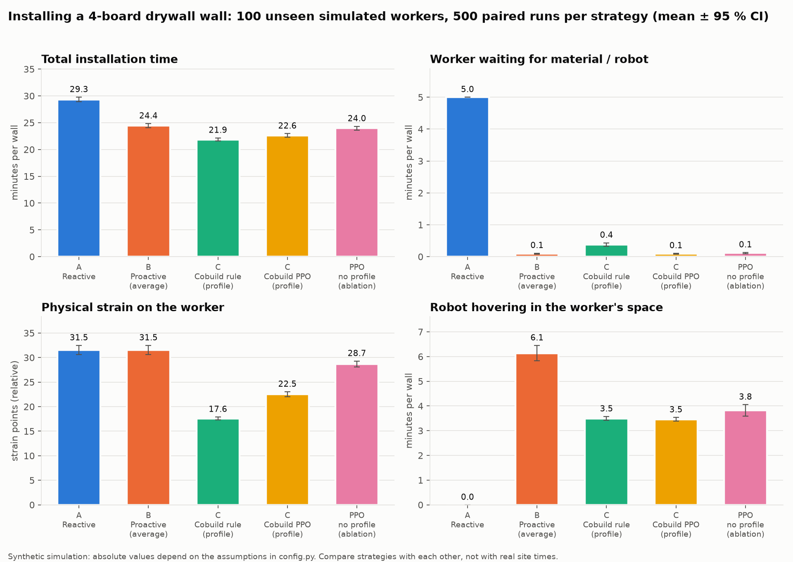
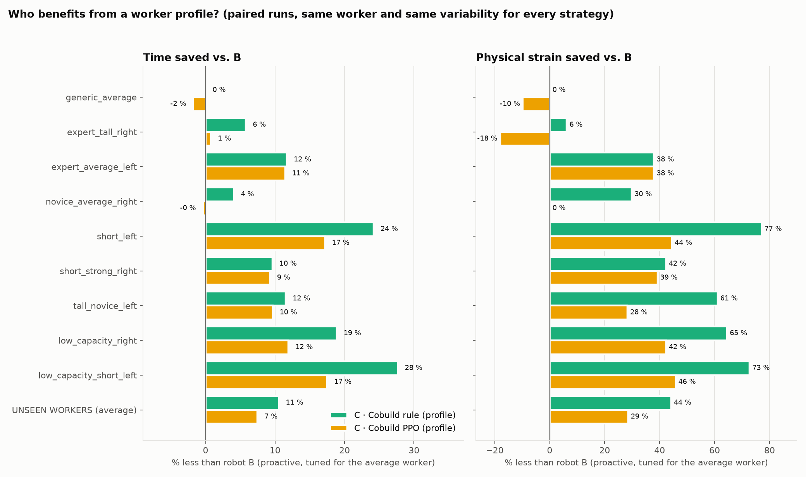
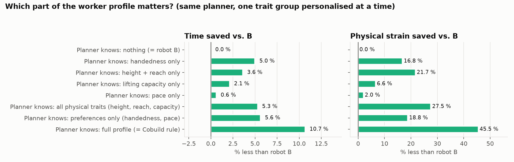
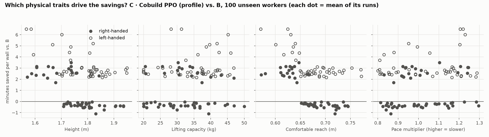
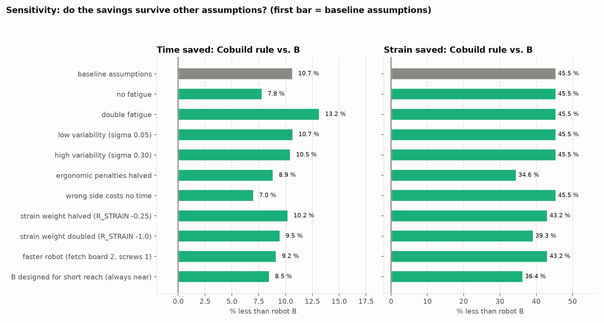
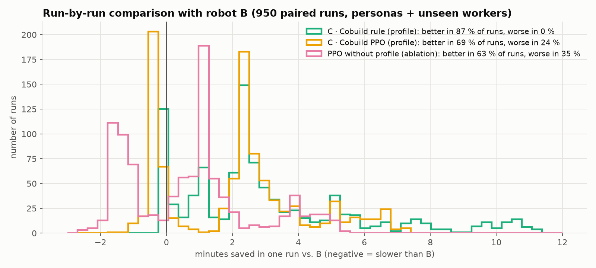

> **Legacy (v1).** Second prototype: the robot *delivered* boards and screws at 12 handover poses and the worker had a
> 4-step abstract task. Kept so it can still be run (`cd v1_handover_poses && python evaluate.py`). The current model, where the
> robot performs the tasks a robot arm would do on drywall (carry, hold, steady, hand tools) is one folder up. See `../docs/MODEL.md` §10.

# Cobuild — personalised robotic assistance for drywall installation

IAAC Research Studio · team 4 (Emma, Amelia, Karthik)

> **Research question:** can worker-specific profiles improve task efficiency compared to
> non-personalised proactive robotic assistance in construction?

A robot assistant supplies a drywall installer with **boards and screws** and can **hold boards on the wall**
while the worker fixes them. Every worker has a **profile** with preferences (pace, handedness) and
**physical characteristics** (height, comfortable reach, lifting capacity, fatigue). We repeat the
installation of a 4-board wall hundreds of times with different robots and measure **how much time and
physical strain** the profile saves.

📖 **How the model works, the reward, the fairness design and the limitations:** [docs/MODEL.md](docs/MODEL.md)

---

## Quick start (Mac / VS Code)

The team's conda environment `Research_Studio` (Python 3.12) already has everything. Otherwise:

```bash
python3 -m venv .venv && source .venv/bin/activate
python -m pip install -r requirements.txt
```

Then, from this folder:

```bash
python -m pytest -q tests          # 1. sanity tests (Gymnasium + SB3 API, fairness checks)
python train.py                    # 2. train PPO with and without the profile (~5 min total)
python evaluate.py                 # 3. repeat the installation many times, results/summary.md + figures
python analysis.py                 # 4. which traits matter + sensitivity to assumptions
python visualize.py --profile low_capacity_short_left --compare   # 5. watch robot B vs. Cobuild
```

Rule-based strategies work without training: `python evaluate.py --no-ppo`.

## What each file does

| File | Role |
|---|---|
| [config.py](config.py) | **every assumption** (durations, weights, ergonomic penalties, reward weights), in one place |
| [profiles.py](profiles.py) | `WorkerProfile`, 8 synthetic personas, the generic average worker, the population sampler |
| [ergonomics.py](ergonomics.py) | how a body becomes time and strain: handover cost, lifting alone vs. held, best pose, when holding pays off |
| [cobuild_env.py](cobuild_env.py) | the Gymnasium environment `CobuildDrywallEnv` (observation, 14 actions, reward, metrics) |
| [strategies.py](strategies.py) | A reactive, B proactive-generic, C Cobuild rule, C Cobuild PPO, PPO-without-profile ablation |
| [train.py](train.py) | trains the two PPO variants → `models/` |
| [evaluate.py](evaluate.py) | paired evaluation on personas + 100 unseen workers → `results/episodes.csv`, `summary.md` |
| [plots.py](plots.py) | figures `results/fig1…fig4` |
| [analysis.py](analysis.py) | trait contribution + sensitivity → `results/analysis.md`, `fig5`, `fig6` |
| [visualize.py](visualize.py) | 2D pygame view, single robot or two robots side by side |
| [tests/](tests/) | automated checks |
| [v0_side_preference/](v0_side_preference/) | the previous prototype (left/right only, incl. the 3D robosuite viewer), kept for reference |

## Watching the simulation

```bash
python visualize.py --profile short_left --strategy C_cobuild_ppo
python visualize.py --profile low_capacity_right --compare                       # B (top) vs. Cobuild rule (bottom)
python visualize.py --profile random --compare --top A_reactive --bottom C_cobuild_ppo
```

- `--profile`: `random`, `generic_average`, or a persona (`expert_tall_right`, `expert_average_left`, `novice_average_right`,
  `short_left`, `short_strong_right`, `tall_novice_left`, `low_capacity_right`, `low_capacity_short_left`)
- `--strategy` / `--top` / `--bottom`: `A_reactive`, `B_proactive_generic`, `C_cobuild_rule`, `C_cobuild_ppo`, `ablation_ppo_no_profile`
- keys: **space** pause · **r** restart · **n** new random worker · **1–8** personas · **+/−** speed · **esc** quit

In compare mode both robots serve the **same worker with the same random variability**, so every difference you see comes from the strategy.
The **green box** is the worker's comfortable handover zone (computed from their height and reach). The **ring** shows where the robot
presents the material: L/R gives the side, green means comfortable and orange means awkward. The worker turns **red** while waiting.
The robot turns red while it hovers with something not needed yet.

(On macOS you may see `objc[...] Class SDL... is implemented in both ...` warnings: pygame and OpenCV both bundle SDL2. They are harmless.)

## Results

Produced by `python train.py && python evaluate.py && python analysis.py` (seed 42, PPO 2M steps per variant).
Full tables: [results/summary.md](results/summary.md) and [results/analysis.md](results/analysis.md).
**These are simulated results under the assumptions in [config.py](config.py), not field measurements.**

### Headline: 100 unseen workers × 5 paired runs (a 4-board wall)

| Strategy | Time (min) | Worker waiting (min) | Strain (pts) | Robot hovering (min) |
|---|---|---|---|---|
| A · Reactive | 29.3 | 5.00 | 31.5 | 0.0 |
| B · Proactive (average worker) | 24.4 | 0.09 | 31.5 | 6.1 |
| **C · Cobuild rule (profile)** | **21.9** | 0.38 | **17.6** | 3.5 |
| **C · Cobuild PPO (profile)** | **22.6** | 0.09 | **22.5** | 3.5 |
| PPO without profile (ablation) | 24.0 | 0.11 | 28.7 | 3.8 |

| How much does the profile save? (paired, 95 % CI) | Time | Strain | Runs better / worse |
|---|---|---|---|
| B → C rule (same planner, + profile) | **−2.6 ± 0.2 min (−10.5 %)** | **−44 %** | 85 % / 0 % |
| B → C PPO | −1.8 ± 0.2 min (−7.5 %) | −29 % | 65 % / 30 % |
| PPO without profile → PPO with profile (same algorithm, + profile) | −1.4 ± 0.04 min (−5.6 %) | −21 % | 99 % / 0 % |
| A → C rule (reactive → Cobuild) | −7.5 ± 0.2 min (−25.5 %) | −44 % | 100 % / 0 % |



### Who benefits? It depends on the body



- For the **generic average worker** the profile adds **nothing** (0 %). That is expected: robot B was designed for them.
- The further a worker is from the average, the more the profile helps. Time savings vs. B range from 4–6 % (expert tall right-handed, average novice)
  to **24–28 %** (short left-handed; short with reduced lifting capacity), and strain falls by up to **~75 %**.
- Strain savings are much larger than time savings: a lot of the gain is **ergonomic** (less bending, stretching and lifting alone), and only part of it turns into time through fatigue.

### Which characteristics matter? (`analysis.py`)



The planner is given the average worker except for **one trait group** copied from the real worker (savings vs. B, time / strain):

| Planner knows… | Time | Strain |
|---|---|---|
| handedness only | −5.0 % | −17 % |
| height + reach only | −3.6 % | −22 % |
| lifting capacity only | −2.1 % | −7 % |
| pace only | −0.6 % | −2 % |
| **preferences** (handedness + pace), roughly what v0 modelled | −5.6 % | −19 % |
| **physical traits** (height + reach + lifting capacity) | −5.3 % | −28 % |
| **full profile** | **−10.7 %** | **−46 %** |

Physical characteristics save **as much time** as preferences and **more strain**. Together they roughly **double** the benefit of a
preference-only profile. Pace barely matters here because a proactive robot with a safety margin absorbs pace differences.



### Does it hold under other assumptions?



Across 10 alternative assumptions (no or double fatigue, low or high variability, ergonomic penalties halved, wrong side costing no time,
different strain weights, a faster robot, a more conservative robot B) the Cobuild rule always beats B: **7–13 % less time and 35–46 % less strain**,
and it is never worse than B in more than 1.6 % of runs. The *size* of the effect depends on the assumptions. The *direction* does not.

### Honest caveats about PPO

- PPO with the profile beats the PPO without it in 99 % of runs, so **the learned agent does use the profile**. But it does not reach the hand-written rule
  (−7.5 % vs. −10.5 % time), and it is **~0.4 min slower than B for right-handed, long-reach workers**, the people B was designed for
  (lower cluster in fig3, and 30 % of runs worse in fig4).
- Why: it learned a robust shortcut. It presents almost everything at *right-mid-near*, which is within everyone's reach but costs the robot an extra tick,
  and it occasionally delivers on the wrong side.
- **It never learned to hold the board.** That action pays off only for some workers and only on upper-row boards, so random exploration rarely finds it
  (more entropy and γ = 0.995 did not change this). The rule-based planner shows it is worth up to ~4 min per wall for low-capacity workers.
- Possible next steps: action masking (`sb3-contrib` MaskablePPO), a factored action (what / side / height / distance), or a curriculum that starts with low-capacity workers.



### How to explain it in one sentence
*In our simulation, a robot that knows the worker's body and preferences saves about 10 % of installation time and roughly 45 % of physical strain
compared with an equally proactive robot designed for the average worker. The benefit is close to zero for workers who resemble that average
and reaches 25–28 % of time for the workers who differ most from it (short, left-handed, lower lifting capacity).*
