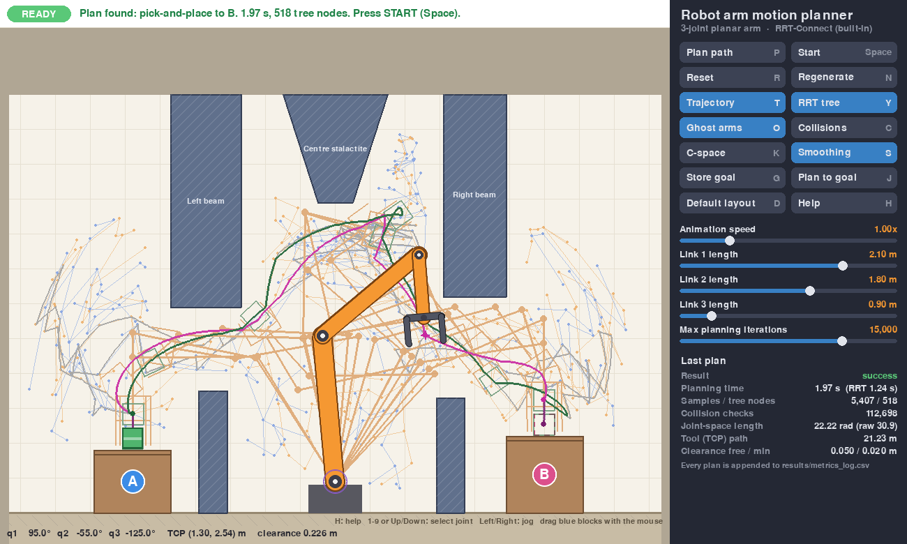
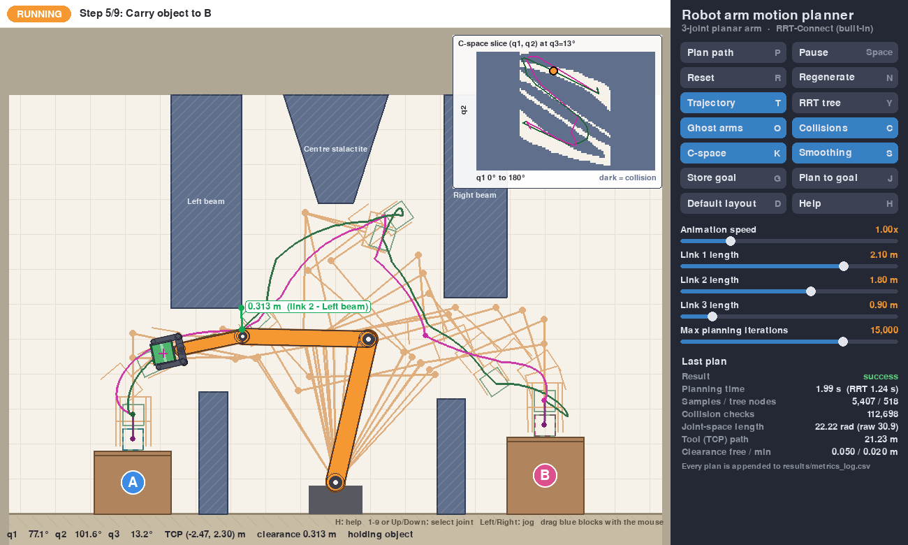

# roboarm: 2D robotic arm motion planning (RRT-Connect pick and place)

An interactive simulator in which a fixed three-joint arm picks up a box at **A**, carries it through a narrow passage between obstacles and places it at **B**. It uses classical motion planning with no machine learning. We built it to learn how classical planners work before we compare them with reinforcement learning.



*After pressing Plan. Thin blue and orange lines show the two search trees that RRT-Connect grew, drawn at the gripper position of each tree node. The grey line is the raw path the planner found. The magenta and green lines are the smoothed path of the tool (without and with the box). The faint orange "skeletons" are snapshots of the whole arm along the motion.*

---

## 1. Quick start

```bash
cd roboarm
pip install -r requirements.txt     # numpy, pygame, pytest
python main.py                      # opens the simulator
python -m pytest -q                 # 43 tests, about 20 s
```

In the window, press **Plan path** (P), then **Start** (Space). After the box reaches B, press **Plan** again and the arm carries it back.

| Control | What it does |
|---|---|
| **Plan path** `P` | Plans the full pick-and-place from the arm's current pose. Planning runs in the background; `Esc` cancels it. |
| **Start / Pause** `Space` | Plays or pauses the planned motion. |
| **Reset** `R` | Arm back home, box back on table A. |
| **Regenerate** `N` | Random obstacle layout. Each candidate is checked by actually planning it, so you only ever get a solvable layout. |
| **Default layout** `D` | Restores the original obstacles. |
| **Trajectory** `T` / **RRT tree** `Y` / **Ghost arms** `O` | Show or hide the tool path, the search trees and the arm snapshots. |
| **Collisions** `C` | Draws the collision shapes, the closest obstacle and its distance, and names of colliding parts. |
| **C-space** `K` | Small plot of the configuration space (see section 4). |
| **Smoothing** `S` | Turns path shortcutting on or off for the next plan. Compare the raw and smoothed path lengths. |
| **Store goal** `G` / **Plan to goal** `J` | Stage C mode: store the current pose, move the arm, then plan a motion back to the stored pose. |
| Mouse drag | Drag any blue obstacle. The plan becomes invalid; press Plan to replan, even mid-task while the arm holds the box. |
| `1`–`9`, `↑` `↓` | Select a joint. `←` `→` rotate it (hold Shift for faster). The arm turns red where it collides. |
| Sliders | Animation speed, length of each link, maximum planning iterations. |
| `+` `-`, `H` | Animation speed, help overlay. |

Useful command-line options:

```bash
python main.py --seed 3                    # repeatable random choices
python main.py --planner ompl              # use the OMPL library instead (pip install ompl)
python main.py --plan --run --time 12 --show cspace,collision --screenshot shot.png   # render a PNG without a window
python benchmark.py --runs 20              # statistics over many plans, no graphics
```

Every adjustable number (sizes, joint limits, obstacle layout, planner settings, colours) is in [config.py](config.py).

---

## 2. What each file does

| File | Role |
|---|---|
| [main.py](main.py) | Entry point. Opens the window, reads the mouse and keyboard, builds the buttons and sliders, runs the frame loop. |
| [config.py](config.py) | All parameters in one place: robot geometry, joint limits, obstacles, planner settings, animation speed, colours. |
| [robot.py](robot.py) | The arm itself. **Forward kinematics** (joint angles → positions), joint limits, gripper geometry, **inverse kinematics** (position → joint angles), straight-line tool motions. Works for any number of joints. |
| [environment.py](environment.py) | The workspace: floor, ceiling, walls, tables A and B, the pedestal, the movable obstacles and the box. Handles dragging and random regeneration. |
| [geometry.py](geometry.py) | Basic 2D maths: distance between segments, point-in-polygon test, rectangles. Vectorised with NumPy so thousands of checks run at once. |
| [collision.py](collision.py) | `CollisionChecker`. Is a pose collision-free? Is a whole motion between two poses collision-free? How far is the robot from the nearest obstacle? |
| [planner.py](planner.py) | **RRT-Connect** and path **shortcutting**. Knows nothing about robots: it only asks the collision checker "is this pose valid?" and "is this motion valid?". |
| [pick_place.py](pick_place.py) | Turns "move the box from A to B" into a sequence of motions: reach above A, descend, grasp, lift, carry, descend, release, lift, return home. |
| [simulation.py](simulation.py) | The live state: current pose, attached box, current plan, the animation, background planning, and invalidating a plan when something changes. |
| [render.py](render.py) | All drawing: robot, obstacles, paths, trees, ghost arms, collision view, C-space plot, panel. |
| [ui.py](ui.py) | Minimal button and slider widgets. |
| [metrics.py](metrics.py) | Path lengths and clearances. Appends every plan to `results/metrics_log.csv`. |
| [benchmark.py](benchmark.py) | Runs the task many times without graphics and prints statistics. This is the tool for comparing planners, or later an RL policy. |
| [ompl_backend.py](ompl_backend.py) | Optional adapter that runs the same planning problems with the OMPL library. |
| [tests/](tests/) | Automated checks, one file per development stage (kinematics, collision, planner, pick-and-place, simulation, OMPL). |

The flow of one "Plan path" click:

```
main.py ─► simulation.request_plan()            (background thread, on copies of robot + scene)
              └─► pick_place.TaskPlanner
                    ├─ robot.ik_solutions()      where must the joints be to grasp at A / place at B?
                    ├─ robot.cartesian_line()    straight vertical approach and retreat
                    ├─ planner.RRTConnect.plan() free-space motions (uses collision.CollisionChecker)
                    ├─ planner.shortcut_path()   smoothing
                    └─ metrics.trajectory_metrics()
         ◄── TaskPlan (list of Moves + gripper actions) ──► simulation.update() animates it
```

---

## 3. Forward kinematics: from joint angles to positions

A configuration of the robot is just its list of joint angles, **q = (q1, q2, q3)**. In this simulator:

- **q1** is the angle of link 1, measured from the horizontal;
- **q2** and **q3** are *relative*: how much each link turns relative to the previous one, like an elbow and a wrist.

Forward kinematics (FK) answers: *given the angles, where is every part of the arm?* You walk along the chain and add one link at a time:

```
θ1 = q1                 θ2 = q1 + q2               θ3 = q1 + q2 + q3       (absolute link angles)
elbow  = base  + L1·(cos θ1, sin θ1)
wrist  = elbow + L2·(cos θ2, sin θ2)
flange = wrist + L3·(cos θ3, sin θ3)
```

The gripper is fixed to the flange, so the **tool centre point** (TCP, the point between the fingers) lies a further 0.26 m along the same direction, and the gripper's angle is θ3. FK always has exactly one answer and is cheap to compute. See `PlanarArm.forward_kinematics` in [robot.py](robot.py).

## 4. Inverse kinematics: from a desired gripper pose to joint angles

Inverse kinematics (IK) is the reverse question: *I want the gripper at point A, pointing straight down; which joint angles achieve that?* This is harder:

- **Several answers** may exist, for example "elbow up" and "elbow down", which reach the same point with very different arm shapes.
- **No answer** may exist if the point is out of reach or needs angles beyond the joint limits.
- Some answers are **unusable** because that arm shape hits an obstacle.

The solver (`PlanarArm.solve_ik`) is iterative (*damped least squares*). It starts from a guess and repeatedly asks "if I nudge each joint slightly, how does the gripper move?" (the Jacobian matrix), then nudges the joints to reduce the error. Starting from about 40 random guesses (`ik_solutions`) finds the different solution families. The task planner keeps only solutions that are collision-free *and* allow a straight vertical approach to the box.

We simplified the task with a **fixed grasp orientation**: the gripper always points straight down at A and B (`GRASP_ANGLE_DEG`). Three joints for three requirements (x, y, angle) means a finite number of solutions.

## 5. Configuration space (C-space)

Imagine a 3D "room" whose three axes are the angles q1, q2 and q3. Every point in that room is **one complete pose of the robot**. This room is the *configuration space*.

- A pose where the arm touches an obstacle is a forbidden point. All forbidden points together form the **C-obstacles**. These are shapes in angle space, and they look nothing like the physical obstacles: one rectangular beam becomes a large, curved, twisted region.
- A **motion** of the robot is a **line** through C-space. A collision-free motion is a line that never enters a C-obstacle.

So "move the arm around obstacles" becomes "find a line through a 3D room with weird walls". That is the trick behind all classical planners. The planner moves a single point, so it never has to think about the arm's shape.



The **C-space** plot (top right, key `K`) is a 2D slice of that room: horizontal = q1, vertical = q2, with q3 fixed at its current value. Dark areas are C-obstacles, the orange dot is the current pose, the coloured curves are the planned motions. With the default layout only about **15 % of C-space is free**, and the free part near A connects to the free part near B only through thin corridors. That is the "narrow passage" in robotics terms.

## 6. How RRT-Connect finds a path

RRT means *Rapidly-exploring Random Tree*. RRT-Connect (Kuffner & LaValle, 2000) grows **two** trees of poses in C-space, one from the start and one from the goal, and tries to join them:

1. **Sample** a random pose `q_rand` anywhere within the joint limits.
2. **Extend** tree A: find its node closest to `q_rand` and take one small step (0.3 rad) towards it. If that short motion is collision-free, add the new pose to the tree.
3. **Connect** tree B: from its node closest to that new pose, keep stepping towards it until it either **reaches** it or hits an obstacle.
4. If it reached it, the two trees touch. Follow the parent links back to both roots and you have the path.
5. Otherwise **swap** the roles of the trees and repeat.

Random sampling makes the trees spread quickly into unexplored space. The greedy "connect" step makes them meet quickly once a straight line between them is free. The method is **probabilistically complete**: if a path exists, the chance of finding it approaches 100 % as iterations increase. It does **not** find the shortest path.

Two practical additions:

- **Several goals.** IK usually gives more than one valid grasp pose. All of them become roots of the goal tree, and the planner uses whichever it reaches first.
- **Shortcutting** (`shortcut_path`). The raw RRT path zig-zags. We repeatedly pick two random points on the path and, if the straight motion between them is collision-free, skip everything in between. In the default task this cuts the joint-space length by roughly 30 % (e.g. 30.9 → 22.2 rad).

The pick-and-place task runs **three** RRT-Connect queries (to A, A→B, back home). Between them are straight vertical approach and retreat motions computed with IK, as a real robot would do to avoid knocking the box sideways.

## 7. How collisions are detected

- **Robot model.** Each link, the palm and the two fingers are **capsules**: a line segment with a thickness, like a sausage. The carried box is its four edges.
- **Obstacles** are **convex polygons** (rectangles and the trapezoid). A capsule hits a polygon if the distance between the capsule's centre line and the polygon is less than its radius plus a **safety margin**. The distance is zero when the line crosses an edge or has an end inside the polygon; otherwise it is the smallest distance to any edge.
- **Self-collision.** Parts that are not directly connected must not touch either, e.g. link 1 versus the gripper. The last link, the gripper and a held box are one rigid piece, so they are not tested against each other.
- **Every link is checked**, not just the gripper. The tests put a small block on each link in turn to prove it.
- **Motions, not just poses.** A motion between two poses is checked at many intermediate poses, spaced so that **no point of the robot moves more than 3 cm** between two checks (`COLLISION_STEP`). This is a standard approximation: an obstacle thinner than about 3 cm could, in principle, slip between two checks. All obstacles here are much thicker.
- **Two margins.** Free-space motions (transit, carry) must keep **5 cm** away from everything (`PLANNING_MARGIN`). The deliberate approach to the table uses **1 cm** (`SAFETY_MARGIN`), because the fingers have to go close to the box and the table.
- **Speed.** A cheap bounding-box test first discards part–obstacle pairs that are far apart (the "broad phase" used in game physics). Exact distances are computed only for nearby pairs. One pose takes about 8 µs, and a full plan does about 100,000 pose checks.

## 8. Why the gripper's shortest path is often impossible for the whole robot

The straight line from A to B *for the gripper* (or any short curve) says nothing about the rest of the arm. In this scene:

- The gripper path may be free, while the **elbow or forearm** passes through a beam or pillar. The arm's *shape* along the way matters, not only where its tip goes.
- A tool path that looks short can require a **large joint motion**. Near the edge of reach a tiny tool movement may need a big swing of the shoulder (q1). The planner measures cost in joint space, the space the motors actually move in.
- To get the arm out of the narrow window above A, it often has to **fold first and unfold later**. In the screenshots the tool path (magenta and green) rises and loops while the ghost arms show the links squeezing through the gaps.
- Even the simplest joint-space path, a straight line in C-space from the grasp pose at A to the place pose at B, collides here. The test `test_direct_motion_is_blocked` checks this. That is why a planner is needed at all.

Compare the panel's **"Joint-space length"** (rad) with **"Tool (TCP) path"** (m), and toggle **Ghost arms** to see whole-arm motion against tool motion.

## 9. Metrics

Shown in the panel after every plan and appended to `results/metrics_log.csv`:

| Metric | Meaning |
|---|---|
| Result | Success or failure (with a plain-language reason in the status bar). |
| Planning time | Wall-clock time for the whole task (IK + RRT + smoothing). The RRT share is in brackets. |
| Samples / tree nodes | Random samples drawn and poses stored in the trees: how much searching was needed. |
| Collision checks | Number of poses tested. The most implementation-independent measure of planning effort. |
| Joint-space length | Sum of joint rotations along the final path (rad). "raw" is before smoothing. |
| Tool (TCP) path | Distance travelled by the point between the fingers (m). |
| Clearance free / min | Closest approach to any obstacle during free-space motions, and over the whole task (the latter includes lifting the box off the table, 2 cm). |

Baseline on the default layout (`python benchmark.py --runs 20`, MacBook, built-in planner): **20/20 successes**, planning time **2.2 ± 0.25 s**, joint-space length **26.1 ± 1.8 rad**, tool path **22.7 ± 1.5 m**, free-space clearance **≥ 0.05 m**. On *unverified* random layouts (`--random-layouts`) about half are solvable. Many jittered layouts genuinely block the passage, which is why the app's Regenerate button only accepts layouts it has verified by planning.

---

## 10. What this simulation does NOT represent

- **No physics.** It is purely kinematic: no mass, gravity, inertia, motor torque, friction or contact forces. The arm moves at a constant joint-space speed and could never fall or sag.
- **No timing or dynamics limits.** A real controller respects velocity, acceleration and jerk limits and turns the path into a smooth *trajectory over time* (time-parameterisation). Here the path is followed at constant speed, with corners.
- **Perfect grasp.** The box attaches rigidly the moment the fingers close; it cannot slip or be pushed. Real grasping is a research field of its own.
- **Perfect knowledge.** The robot knows every obstacle exactly. There are no sensors, cameras, noise or calibration errors, and no moving obstacles or people.
- **2D only.** Real arms have 6–7 joints in 3D, so the C-space has 6–7 dimensions. The ideas are identical; the numbers are larger and the visualisation is impossible.
- **Simplified geometry.** Capsules and convex polygons instead of meshes. Motions are checked at 3 cm resolution, not continuously.
- **No safety system.** Real robots near people have speed and separation monitoring, force limits and emergency stops.
- **Orientation of the carried box is free** during transport (it may tilt). Keeping it upright, as with liquids, would need a *constrained* planner.

---

## 11. Next steps

### OMPL (and later MoveIt 2)

The planner is already swappable. Both planners follow the same interface: `plan(start, goals, problem)`, where `problem` offers only `is_valid(q)` and `edge_valid(qa, qb)`. [ompl_backend.py](ompl_backend.py) wraps **OMPL**, the planning library behind MoveIt 2, which now installs with pip and **without ROS**:

```bash
pip install ompl                          # wheels for macOS arm64 / Linux, Python 3.10+
python main.py --planner ompl             # OMPL's RRTConnect on exactly the same problem
python main.py --planner ompl --ompl-algorithm PRM        # or RRT, KPIECE1, BITstar, RRTstar ...
python benchmark.py --planner ompl --ompl-algorithm BITstar --runs 20
```

The adapter registers our collision checker as OMPL's validity checker and motion validator, so comparisons are fair: same robot, same scene, same margins. Optimising planners such as RRT\* or BIT\* trade planning time for shorter paths, which is easy to see in the benchmark CSV. (On exit, the OMPL 2.0 wheel may print harmless "nanobind: leaked …" messages.)

MoveIt 2 adds what this project leaves out: 3D meshes, a real robot description (URDF), time-parameterised trajectories and execution on hardware. The concepts in this README transfer directly.

### Comparing with reinforcement learning

The project is set up so an RL agent can be judged with the **same yardstick**:

1. **Reuse the world, not the planner.** A Gymnasium environment can wrap `PlanarArm`, `Environment` and `CollisionChecker` directly. Observation: joint angles (+ box/target positions, + distances to obstacles). Action: small joint-angle changes. Reward: progress towards the goal, a penalty per step, and a large penalty for collision (`CollisionChecker.is_valid`, or `clearance` for a softer signal).
2. **Measure with `metrics.trajectory_metrics`.** Joint-space length, tool path length and clearance computed the same way as for RRT-Connect, plus success rate over many random layouts (`benchmark.py --random-layouts` gives the classical baseline).
3. **Expect different strengths.** The planner needs no training and is always collision-free when it succeeds, but it plans from scratch every time (about 2 s) and its paths are not smooth. A trained policy reacts in milliseconds and can generalise across layouts, but needs long training and offers no guarantee of avoiding collisions. Planning effort (samples, collision checks) against training effort (environment steps) is a meaningful comparison for the studio.
4. **Hybrid ideas** worth exploring: RL that chooses *where* RRT samples, RL that refines an RRT path, or RRT as a teacher for imitation learning.

---

## 12. Troubleshooting

- **"No path found in N samples".** Raise *Max planning iterations*, or drag an obstacle to widen the passage.
- **"…out of reach".** The link lengths are too short for A or B; lengthen them with the sliders.
- **"No collision-free grasp pose at A (…)".** Something blocks the vertical approach above the box; the message names the parts.
- **"The arm's current pose is in collision".** You dragged an obstacle onto the arm (it is drawn red). Move it away, or press Reset.
- **The window is too large or small.** Change `WINDOW_WIDTH`, `WINDOW_HEIGHT` and `VIEW_X_RANGE` in [config.py](config.py).
- **More joints.** Add entries to `LINK_LENGTHS`, `LINK_RADII`, `JOINT_LIMITS_DEG` and `HOME_CONFIG_DEG` in config.py. Kinematics, IK, collisions and the planner all work for any number of joints. Re-check that the home pose is collision-free (the arm is drawn red if not).
